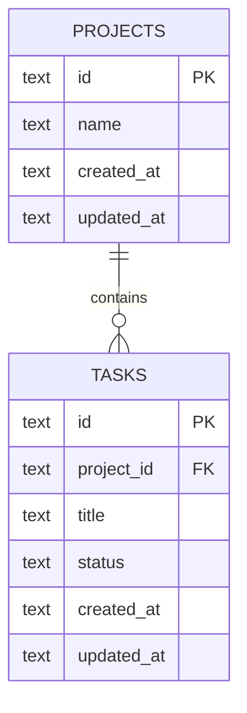

# Week 05 Database CRUD

Compare the same project-management feature using **SQLite relational tables**
and **Redis key-value storage with embedded JSON**. The unified FastAPI surface
supports creating, listing, reading, updating and deleting projects and tasks.
Choose the engine in each route. The data stores are independent comparisons.

This local backend needs **no LLM API key**. AI assistance was used to generate
and audit the project; the running application is ordinary database CRUD.

## Access patterns and models

A project contains a name and a bounded task list. The common operation fetches
one whole project. SQLite also supports filtering and joining tasks across
projects. The Redis model optimizes fetching one complete aggregate by its key.



SQLite stores the project name once. Each task's facts depend on its own key,
and the foreign key expresses ownership without copying the parent's attributes.
That supports the 3NF design. The SQL definitions are in
[src/schema.sql](src/schema.sql).

```sql
CREATE TABLE projects (
    id TEXT PRIMARY KEY NOT NULL,
    name TEXT NOT NULL CHECK (length(trim(name)) BETWEEN 1 AND 100),
    created_at TEXT NOT NULL,
    updated_at TEXT NOT NULL
);
CREATE TABLE tasks (
    id TEXT PRIMARY KEY NOT NULL,
    project_id TEXT NOT NULL REFERENCES projects(id) ON DELETE CASCADE,
    title TEXT NOT NULL CHECK (length(trim(title)) BETWEEN 1 AND 200),
    status TEXT NOT NULL DEFAULT 'todo' CHECK (status IN ('todo', 'done')),
    created_at TEXT NOT NULL,
    updated_at TEXT NOT NULL
);
CREATE INDEX tasks_project_id ON tasks(project_id);
```

Redis stores the equivalent document as a JSON string at
`week05:project:<UUID>`. One GET returns the parent and its embedded children:

```json
{
  "id": "365f04a3-7ec3-49ba-9742-8f39b5ff4707",
  "name": "Classroom release",
  "created_at": "2026-11-19T00:00:00+00:00",
  "updated_at": "2026-11-19T00:00:00+00:00",
  "tasks": [
    {
      "id": "76491a75-350f-4ff4-84e3-c43ec1b60fd3",
      "title": "Review the data model",
      "status": "todo",
      "created_at": "2026-11-19T00:00:00+00:00",
      "updated_at": "2026-11-19T00:00:00+00:00"
    }
  ]
}
```

This uses standard Redis GET/SET, so no RedisJSON module is required. A task
update watches the project key, reads the aggregate, changes the embedded item,
and commits the replacement with MULTI/EXEC. If another writer changes the key,
the operation retries up to eight times, then returns 409. Deleting a project
deletes its entire document. Listing uses SCAN and is suitable for the small
classroom dataset. Add an index or change the model for large global listings.
Redis's aggregate has a 100-task limit. The SQL schema can support larger lists.

## Setup on Windows PowerShell

Install Python through [uv](https://docs.astral.sh/uv/getting-started/installation/)
and start Docker Desktop. Open PowerShell inside this folder.

```powershell
uv python install 3.11
uv sync --locked
docker compose up -d
uv run python -m uvicorn src.api:create_app --factory --host 127.0.0.1 --port 8000
```

Open http://localhost:8000/docs for the interactive API. Leave the server
terminal running. SQLite creates its tables in `data/projects.db` on startup.
There is no migration or seed step for this new demonstration database. The
walkthrough creates real records and cleans up only the records it creates.

Docker runs Redis with append-only persistence in a named volume. The service
binds to loopback for this local exercise. The default fsync policy can lose
approximately the last second of writes on a host failure. The API has no
login system and is intended for local use.

## CRUD through the unified API

| Method | Endpoint | Body or result |
| --- | --- | --- |
| POST | `/{engine}/projects` | `{"name":"Release"}` returns 201 and generated UUID |
| GET | `/{engine}/projects` | List parent summaries |
| GET | `/{engine}/projects/{id}` | Full project and tasks |
| PUT | `/{engine}/projects/{id}` | `{"name":"Revised release"}` |
| DELETE | `/{engine}/projects/{id}` | 204, removes the project and its tasks |
| POST | `/{engine}/projects/{id}/tasks` | `{"title":"Review model"}` |
| PUT | `/{engine}/projects/{id}/tasks/{task_id}` | `{"title":"Model reviewed","status":"done"}` |
| DELETE | `/{engine}/projects/{id}/tasks/{task_id}` | 204 |

Set engine to `sql` or `redis`. Invalid input returns 400, missing records 404,
write conflicts 409, and unavailable storage 503. Inputs have bounded lengths
and reject extra fields. Each write to SQLite is a transaction, with parameterized
values and foreign keys enabled. Exceptions roll back the transaction and every
connection closes. Redis data returned by the API is ordinary JSON.

## Terminal walkthrough and direct inspection

In a second terminal, run these separately:

```powershell
uv run python -m src.demo sql --pause
uv run python -m src.demo redis --pause
```

Press Enter to advance each step. Both walkthroughs run real CRUD against their
database engine. The SQL script prints directly queried rows, attempts an orphan
insert, and verifies that child rows disappear after deleting the parent. The
Redis script prints the actual GET result and verifies the key is gone after
deleting the document.

To inspect Redis independently:

```powershell
docker compose exec redis redis-cli --scan --pattern "week05:project:*"
docker compose exec redis redis-cli GET "week05:project:PASTE-PROJECT-ID"
```

## Tests

```powershell
uv run python -m pytest -v
```

The default suite uses a real temporary SQLite file and a **fakeredis simulator**
for Redis. To run the same tests against Docker Redis, with the service running:

```powershell
$env:REDIS_URL = "redis://localhost:6379/0"
uv run python -m pytest -v
```

The Redis tests use randomly prefixed keys and remove their records after each test. See
[docs/QA.md](docs/QA.md) for the evidence and remaining recording checks.

## AI disclosure

ChatGPT generated the initial schema, application, tests, and documents, reviewed
the draft, and executed the local tests. The audit found missing SQLite error
handlers in the HTTP layer, then added controlled responses and regression tests.
The exact drafting prompt and before/after example are in
[ai_prompt_log.md](ai_prompt_log.md). The student's remaining steps are real Redis
verification on their machine, reviewing the implementation, publishing the
repository, and recording the demonstration.

References · [SQLite foreign keys](https://www.sqlite.org/foreignkeys.html) and
[Redis optimistic transactions](https://redis.io/docs/latest/develop/using-commands/transactions/).
